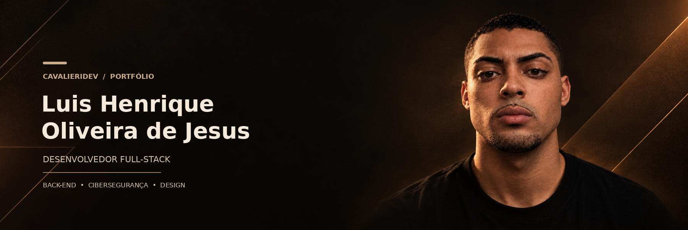
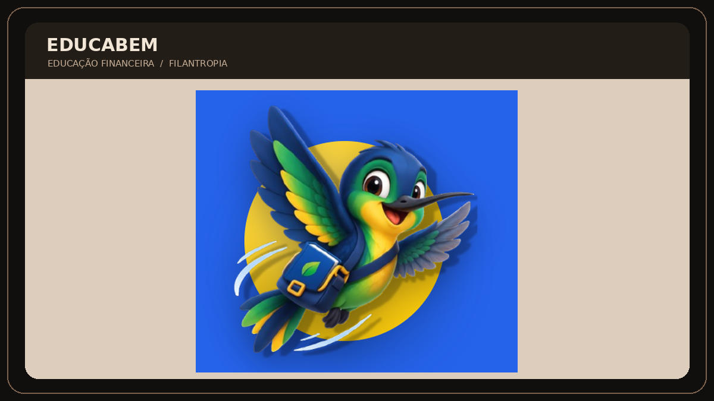
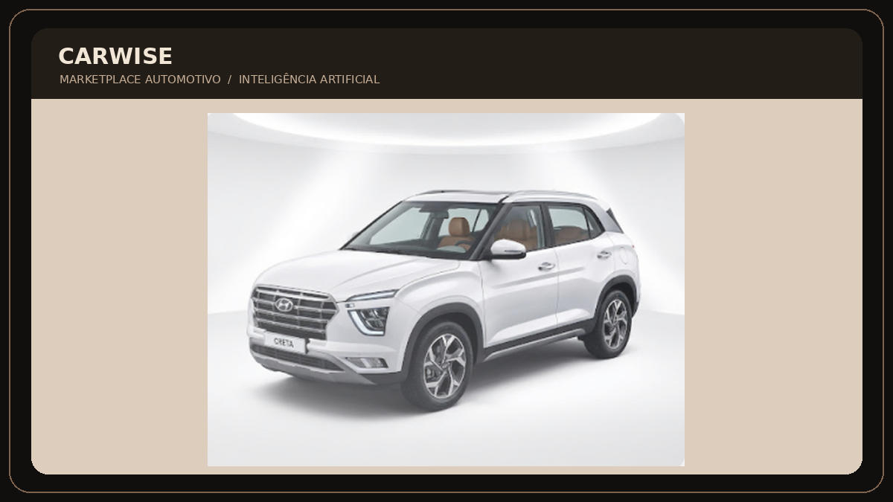

  

  

  
  
  

---

## Sobre mim

Sou **Desenvolvedor Full-Stack**, focado em criar soluções tecnológicas com impacto real. Trabalho com o ecossistema **Java e Spring Boot no back-end**, combinado a **HTML, CSS, JavaScript e React no front-end**. Também utilizo **Figma e Canva** na prototipação e construção visual de ideias.

Tenho vivência prática na estruturação de MVPs, em metodologias ágeis como **Scrum** e na componentização de interfaces. Gosto de entender as regras de negócio a fundo, pensar na experiência e na retenção de usuários e transformar necessidades reais em soluções funcionais e envolventes.

Meu próximo passo é aprofundar meus conhecimentos em **cibersegurança**, conectando práticas de proteção à construção, evolução e manutenção dos sistemas que desenvolvo.

  
  

## Tecnologias e ferramentas

  

## Projetos em destaque

<table>
  <tr>
    <td width="50%" valign="top">
      
      <h3>EducaBem</h3>
      
Plataforma de <strong>educação financeira e doação</strong>, criada para incentivar a filantropia, fortalecer a igualdade e apoiar pessoas na superação da inadimplência.

      
Projeto desenvolvido em equipe.

      
    </td>
    <td width="50%" valign="top">
      
      <h3>CarWise</h3>
      
Marketplace de <strong>soluções automotivas com apoio de IA</strong>, com recursos para auxiliar em diagnósticos, localizar oficinas próximas e contratar assinaturas de manutenção preventiva.

      
Projeto desenvolvido em equipe.

      
    </td>
  </tr>
</table>

---

## Vamos nos conectar?

  
  
  

  © Luis Henrique Oliveira de Jesus · Código com propósito, atenção aos detalhes e uma boa dose de cappuccino.

